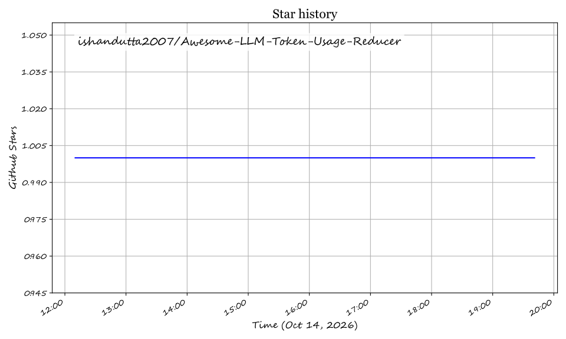

<div align="center">

# ⚡ Awesome LLM Token Usage Reducer

<p align="center">
  
</p>

### Curated Directory of Context Compression Engines, Output Filters, Semantic Caches & Prompt Efficiency Tools

<p align="center">
  <a href="https://github.com/ishandutta2007/Awesome-Awesome-Awesome"></a><a href="https://discord.gg/jc4xtF58Ve"></a>
  <a href="https://github.com/ishandutta2007/Awesome-LLM-Token-Usage-Reducer/stargazers"></a>
  <a href="https://github.com/ishandutta2007/Awesome-LLM-Token-Usage-Reducer/network/members"></a>
  <a href="https://github.com/ishandutta2007/Awesome-LLM-Token-Usage-Reducer/blob/main/LICENSE"></a>
  <a href="https://github.com/ishandutta2007/Awesome-LLM-Token-Usage-Reducer/pulls"></a>
  <a href="https://github.com/ishandutta2007"></a>
</p>

<p align="center">
  <b>Cut LLM API costs by 60%–90% 💸 • Eliminate context window pollution 🧠 • Supercharge autonomous AI coding agents 🚀</b>
</p>

</div>

---

## 📑 Table of Contents

- [🔍 Overview & Why Token Reduction Matters](#-overview--why-token-reduction-matters)
- [📊 Sector Overview & Market Dynamics](#-sector-overview--market-dynamics)
- [🏢 SaaS & Hosted Platforms](#-saas--hosted-platforms)
- [💻 Open-Source GitHub Projects](#-open-source-github-projects)
  - [🔥 Top Open-Source Repositories (Ranked by Stars)](#-top-open-source-repositories-ranked-by-stars)
  - [🧱 Architectural Blueprints & Stacks](#-architectural-blueprints--stacks)
- [🎯 Key Token Reduction Techniques](#-key-token-reduction-techniques)
- [📈 Star History](#-star-history)
- [🤝 How to Contribute](#-how-to-contribute)
- [💖 Support & Community](#-support--community)
- [⚠️ Disclaimer](#-disclaimer)

---

## 🔍 Overview & Why Token Reduction Matters

As developers and enterprises transition from simple chat completions to multi-turn **AI coding agents** (Claude Code, Cursor, Aider, Roo Code) and high-throughput **LLM pipelines**, token consumption explodes exponentially:

1. **Context Window Exhaustion**: Running terminal commands (`git status`, `cargo test`, build logs) injects thousands of repetitive, low-signal tokens into the active context window, crowding out model reasoning capacity.
2. **Soaring Inference Costs**: Input tokens are billed repeatedly on every conversational turn; compressing redundant context saves up to **90% on monthly LLM API bills**.
3. **Latency & TTFT (Time To First Token)**: Smaller input contexts dramatically reduce prefill computation time and accelerate agent feedback loops.

This repository tracks the leading **SaaS platforms** and **open-source developer tools** designed specifically to trim token bloat through **context compression**, **command output filtering**, **semantic caching**, and **output behavior shaping**.

---

## 📊 Sector Overview & Market Dynamics

The global market for **LLM context optimization, AI gateways, and inference acceleration tooling** is projected to grow from **$2.4 Billion in 2024 to over $16.5 Billion by 2030**, advancing at a compound annual growth rate (**CAGR of ~38%**). 

The sector is currently **moderately-to-highly fragmented** rather than a winner-take-all monopoly:
- **No single player monopolizes the entire stack**: Development teams deploy heterogeneous layers tailored to specific friction points — adopting terminal proxies (`RTK`, `Caveman`) for local agent CLI sessions, symbol graph indexers (`Token Savior`, `Graphify`, `Repomix`) for code context packaging, prompt pruners (`LLMLingua`, `LeanCtx`) for RAG retrieval, and managed gateways (`Cloudflare AI Gateway`, `Portkey`, `Helicone`) for cloud routing and semantic caching.
- **Active M&A & Infrastructure Bundling**: Cloud infrastructure incumbents and enterprise cybersecurity leaders are actively acquiring and consolidating gateway innovators (e.g., Palo Alto Networks acquiring Portkey for $140M, Mintlify acquiring Helicone), signaling strong enterprise demand for standardized token governance and cost controls.

---

## 🏢 SaaS & Hosted Platforms

The table below compiles premier hosted platforms and managed AI proxies that deliver token caching, cost governance, prompt compression, and routing. Sorted by **Company Size (Revenue / Valuation)** in descending order:

| 🏷️ Product & Provider | 💰 Valuation / Company Size | 💳 Starting Tier Pricing | 🎁 Free Tier Limits | ⚙️ Token Reduction Mechanism & Highlights |
| :--- | :--- | :--- | :--- | :--- |
| **[Cloudflare AI Gateway](https://developers.cloudflare.com/ai-gateway/)**<br>*(Cloudflare, Inc.)* | **$35B+ Market Cap**<br>($1.3B+ Annual Revenue; NYSE: NET) | **$5.00 / month**<br>*(Workers Paid base)* | **100,000 requests / day**<br>free forever on Cloudflare Free Plan | Universal AI gateway with response caching (exact and semantic), automated request deduplication, rate-limiting, and multi-model fallback across 10+ LLM providers to avoid re-generating identical tokens. |
| **[Braintrust](https://www.braintrust.dev)**<br>*(Braintrust Data, Inc.)* | **$400M Valuation**<br>($121M VC funding raised) | **$249.00 / month**<br>*(Pro Plan)* | **1 GB trace data / month**<br>+ 10,000 scores + $10/mo model credits free forever | Enterprise LLM proxy with prompt caching, compression algorithms, automated token counting, and real-time cost tracking to pinpoint expensive context leaks. |
| **[Portkey](https://portkey.ai)**<br>*(Palo Alto Networks / Portkey)* | **$140M Valuation**<br>($18M VC raised; Acquired 2026) | **$49.00 / month**<br>*(Developer / Pro Tier)* | **10,000 requests / month**<br>free forever (no credit card required) | AI Gateway featuring semantic caching (slashing repeated prompt token spend by 20%–40%), smart fallback routing to cheaper LLMs, and prompt template parameterization. |
| **[PromptPerfect](https://promptperfect.jina.ai)**<br>*(Jina AI GmbH)* | **$100M Valuation**<br>($37.5M VC funding raised) | **$9.99 / month**<br>*(Standard Plan)* | **20 prompt optimization credits**<br>free upon account signup | Automated prompt compression and optimization engine that prunes conversational filler words, condenses system prompts, and trims input token length without degrading output quality. |
| **[MindStudio](https://www.mindstudio.ai)**<br>*(YouAi, Inc.)* | **$85M Valuation**<br>($36M VC funding raised) | **$20.00 / month**<br>*(Individual Plan)* | **1 active agent & 1,000 runs / month**<br>free forever | Agent Skills Plugin (`@mindstudio-ai/agent`) wrapping 120+ business tool APIs into typed method calls, eliminating massive token-heavy client integration schemas and context boilerplate. |
| **[Helicone](https://www.helicone.ai)**<br>*(Mintlify / Helicone)* | **$80M Implied Valuation**<br>($500K+ YC W23; Acquired 2026) | **$20.00 / month**<br>*(Pro Plan)* | **10,000 requests / month**<br>+ 1 GB storage free forever | Open-architecture LLM proxy with semantic caching, saving up to 80% on identical or fuzzy-matched queries; provides per-prompt token breakdown and cost optimization dashboards. |
| **[OpenRouter](https://openrouter.ai)**<br>*(OpenRouter)* | **$15M+ ARR**<br>*(Bootstrapped & profitable)* | **$5.00 credit deposit**<br>*(Pay-as-you-go)* | **Unlimited free model calls**<br>to 20+ models (rate-limited to 20 req/min) | Unified API gateway routing prompts across 300+ LLMs; automatically routes tasks to the lowest-cost model, supports prompt compression middleware, and provides token fallback pools. |

---

## 💻 Open-Source GitHub Projects

### 🔥 Top Open-Source Repositories (Ranked by Stars)

Each open-source repository is indexed below and strictly sorted by **GitHub Stargazer Count** in descending order. Stars_Badges link directly to the respective repo's stargazers page:

1. ### **[Graphify](https://github.com/Graphify-Labs/graphify)** [](https://github.com/Graphify-Labs/graphify/stargazers)
   - **Focus**: Codebase knowledge graph extraction for ultra-lean queries.
   - **Highlights**: Extracts entire repository codebases into compact, structural knowledge graphs. On mixed test corpora (52 files), achieves **71.5x fewer tokens per query** compared to feeding raw source files. Uses SHA-256 caching and `--watch` auto-sync to update only modified source files.

2. ### **[Caveman](https://github.com/JuliusBrussee/caveman)** [](https://github.com/JuliusBrussee/caveman/stargazers)
   - **Focus**: Output-side prose token compression for Claude Code and Codex.
   - **Highlights**: Viral plugin that enforces terse, article-free responses to cut LLM output token consumption by **~75%**. Strips filler words, sycophantic greetings, and redundant preambles while keeping code blocks and technical terminology 100% syntactically accurate. Features three configurable compression levels: `lite`, `full`, and `ultra`.

3. ### **[RTK (Rust Token Killer)](https://github.com/rtk-ai/rtk)** [](https://github.com/rtk-ai/rtk/stargazers)
   - **Focus**: Ultra-fast CLI proxy for AI terminal coding assistants.
   - **Highlights**: Written in Rust with `<10ms` startup latency. Sits transparently between your terminal shell and coding assistant (Claude Code, Cursor, Aider, Gemini CLI), intercepting and compressing command outputs by **60%–90%**. Yields **91.8% savings on cargo test**, **80.8% on git status**, and **78.3% on find/grep**. Zero configuration, no API keys, and built-in telemetry via `rtk gain`.

4. ### **[OmniRoute](https://github.com/diegosouzapw/OmniRoute)** [](https://github.com/diegosouzapw/OmniRoute/stargazers)
   - **Focus**: Multi-provider AI gateway with input deduplication and quota failover.
   - **Highlights**: Routes requests across 290+ AI providers and 500+ models. Automatically compresses bloated inputs, verbose JSON dumps, and repeated build logs before sending prompts downstream, achieving **15%–95% token savings** depending on payload structure.

5. ### **[Headroom](https://github.com/headroomlabs-ai/headroom)** [](https://github.com/headroomlabs-ai/headroom/stargazers)
   - **Focus**: Context compression library & proxy with CCR architecture.
   - **Highlights**: Features the *SmartCrusher* engine to eliminate duplicate log streams, boilerplate code, and verbose data structures. Implements **Compression, Concatenation, Recovery (CCR)** architecture, simulation mode to preview token savings before calling downstream models, and direct adapters for Vercel AI SDK, OpenAI, Anthropic, and n8n nodes.

6. ### **[LiteLLM](https://github.com/BerriAI/litellm)** [](https://github.com/BerriAI/litellm/stargazers)
   - **Focus**: Unified LLM proxy with prompt caching and cost tracking.
   - **Highlights**: Call 100+ LLMs using the standard OpenAI format. Features native support for Anthropic prompt caching, semantic caching (via Redis), token-bucket rate limiting, and real-time spend/token analytics to eliminate redundant completions.

7. ### **[Repomix](https://github.com/yamadashy/repomix)** [](https://github.com/yamadashy/repomix/stargazers)
   - **Focus**: Codebase packing tool with intelligent token compression.
   - **Highlights**: Packs your entire code repository into a single AI-optimized file. The `--compress` flag strips implementation details while preserving imports, class signatures, function definitions, and exported interfaces. Includes `--token-count-tree` to pinpoint context-heavy files.

8. ### **[Portkey AI Gateway](https://github.com/Portkey-AI/gateway)** [](https://github.com/Portkey-AI/gateway/stargazers)
   - **Focus**: Enterprise-grade open-source AI gateway.
   - **Highlights**: Sub-millisecond AI gateway written in TypeScript. Provides built-in semantic caching, prompt templating, automated retries, and fallback routing to save 20%–40% in token volume across production workloads.

9. ### **[GPTCache](https://github.com/zilliztech/GPTCache)** [](https://github.com/zilliztech/GPTCache/stargazers)
   - **Focus**: Semantic cache for LLM queries to cut API costs and latency.
   - **Highlights**: Stores prompt embeddings and vector search indexes to return cached responses for semantically similar prompts. Drops LLM token consumption to zero on recurring questions, reducing API latency from seconds to milliseconds.

10. ### **[Code2Prompt](https://github.com/mufeedvh/code2prompt)** [](https://github.com/mufeedvh/code2prompt/stargazers)
    - **Focus**: CLI codebase-to-prompt generator with token counting.
    - **Highlights**: Converts code repositories into well-structured LLM prompts with Jinja templates, file filtering, and token estimation. Uses `--tokens` to calculate precise token loads before dispatching queries to OpenAI, Anthropic, or local models.

11. ### **[LLMLingua](https://github.com/microsoft/LLMLingua)** [](https://github.com/microsoft/LLMLingua/stargazers)
    - **Focus**: Microsoft's state-of-the-art prompt compression library.
    - **Highlights**: Compresses long prompts and KV-caches by **up to 20x** with minimal degradation in downstream task performance. Uses small language models (like GPT-2 or LLaMA-7B) to measure token perplexity and prune low-information tokens before feeding context to heavy LLMs.

12. ### **[claude-token-efficient](https://github.com/drona23/claude-token-efficient)** [](https://github.com/drona23/claude-token-efficient/stargazers)
    - **Focus**: System prompt template for curbing Claude output verbosity.
    - **Highlights**: A concise, battle-tested `CLAUDE.md` template containing ~15 precise constraints targeting output behavior. Eliminates unsolicited apologies, decorative commentary, and scope creep, yielding measurable cost-to-green reductions on coding benchmarks.

13. ### **[Token Savior](https://github.com/Mibayy/token-savior)** [](https://github.com/Mibayy/token-savior/stargazers)
    - **Focus**: Codebase symbol indexer MCP server & Bash output compactor.
    - **Highlights**: Replaces raw `cat` file injections with symbol-graph pointer navigation (functions, classes, call trees). Includes 34 pre-configured Bash output filters and a PreToolUse command rewriter that reduces injected characters by **97% across 170+ real developer sessions**.

14. ### **[Sigmap](https://github.com/manojmallick/sigmap)** [](https://github.com/manojmallick/sigmap/stargazers)
    - **Focus**: Zero-dependency structural symbol map MCP server.
    - **Highlights**: Generates compact signature maps across 38 programming languages without external dependencies. Allows AI assistants to inspect class signatures, method parameters, and type definitions without consuming tokens on full method implementations.

15. ### **[LeanCtx](https://github.com/jia-gao/leanctx)** [](https://github.com/jia-gao/leanctx/stargazers)
    - **Focus**: Drop-in prompt compression middleware using LLMLingua-2.
    - **Highlights**: Python SDK middleware that cuts LLM token bills by 40%–60% with zero changes to downstream business logic. Prunes redundant text in RAG chunks and conversational history before payload transmission.

---

### 🧱 Architectural Blueprints & Stacks

To build a resilient, self-hosted token optimization pipeline, practitioners compose complementary tools across three distinct operational layers:

```
┌─────────────────────────────────────────────────────────────┐
│ 1. LOCAL DEVELOPER & TERMINAL LAYER                         │
│    • RTK (Rust Token Killer)  → Intercepts shell commands   │
│    • Caveman / CLAUDE.md      → Enforces concise output     │
└──────────────────────────────┬──────────────────────────────┘
                               │
┌──────────────────────────────▼──────────────────────────────┐
│ 2. CONTEXT STRUCTURING & CODEBASE PACKING                   │
│    • Token Savior / Sigmap    → Symbol-level AST navigation │
│    • Repomix / Code2Prompt    → Pruned repo bundling        │
│    • Graphify                 → Graph queries over raw code │
└──────────────────────────────┬──────────────────────────────┘
                               │
┌──────────────────────────────▼──────────────────────────────┐
│ 3. GATEWAY, CACHING & RUNTIME COMPRESSION                   │
│    • LLMLingua / LeanCtx      → Perplexity token pruning    │
│    • GPTCache / Portkey       → Semantic vector caching     │
│    • LiteLLM / Cloudflare GW  → Routing & provider caching  │
└─────────────────────────────────────────────────────────────┘
```

---

## 🎯 Key Token Reduction Techniques

| Technique | Description | Typical Savings | Best Tool Examples |
| :--- | :--- | :--- | :--- |
| **Command Output Filtering** | Strips ANSI escape sequences, progress bars, and redundant logs from CLI commands before reaching context. | 60% – 92% | `RTK`, `Token Savior` |
| **Symbol-Graph Navigation** | Replaces brute-force file reading (`cat`) with AST-indexed definitions and type signatures. | 70% – 85% | `Token Savior`, `Sigmap`, `Graphify` |
| **Semantic & Exact Caching** | Caches previous question-answer vectors to return cached completions without calling LLMs. | 100% on hits | `GPTCache`, `Portkey`, `Cloudflare AI Gateway` |
| **Perplexity-Based Pruning** | Uses small SLMs to evaluate token importance and strip low-information words. | 40% – 60% | `LLMLingua`, `LeanCtx` |
| **Output Behavior Shaping** | Constrains conversational fluff, unsolicited apologies, and sycophantic greetings via system rules. | 20% – 75% | `Caveman`, `claude-token-efficient` |
| **Codebase Interface Packing** | Exports structural types, function signatures, and docstrings while stripping function bodies. | 50% – 80% | `Repomix --compress` |

---

## 📈 Star History

[](https://star-history.dera.page/#ishandutta2007/Awesome-LLM-Token-Usage-Reducer&type=date&legend=top-left)

---

## 🤝 How to Contribute

Contributions are warmly welcomed! Help keep this directory current, accurate, and developer-friendly:

1. **Fork the repository** to your GitHub account.
2. **Add or update an entry** in `README.md`.
   - Maintain the alphabetical or sorted structure.
   - For SaaS products, include verifiable starting prices, specific free tier limits, and valuation/revenue metrics.
   - For open-source tools, include the repository URL, social Stars_Badge linked to `/stargazers`, and a concise 2–3 sentence description.
3. **Ensure semantic clarity**: Focus strictly on verifiable token reduction capabilities and benchmarks.
4. **Submit a Pull Request** with a clear explanation of your additions.

---

## 💖 Support & Community

Thank you for exploring **Awesome-LLM-Token-Usage-Reducer**! If this curated repository has helped you cut API costs, avoid context window exhaustion, or accelerate AI agent workflows, please consider supporting the project:

- ⭐ **Star this repository** on GitHub to help other engineers discover it.
- 🍴 **Fork and contribute** your tools, benchmarks, and architectural patterns.
- 📢 **Share with peers**, AI engineers, and open-source communities.
- ☕ **Sponsor / Buy Me a Coffee**: Support ongoing research, benchmarks, and updates directly via the [GitHub Sponsor Dashboard](https://github.com/sponsors/ishandutta2007).

---

## ⚠️ Disclaimer

- This directory is a **community-curated index** provided for informational and educational purposes. Inclusion does not constitute an endorsement.
- **Accuracy Trade-off**: Aggressive context compression can discard subtle requirements or degrade reasoning on complex edge cases. Always benchmark compression ratios and task success rates against your specific production workload before standardizing.
- Self-hosted proxy components and custom system prompts should undergo integration testing to verify that tool calling schemas and code syntax remain fully valid.

---

<div align="center">
  <sub>Curated with care by <a href="https://github.com/ishandutta2007">Ishan Dutta</a> and the global open-source AI community.</sub>
</div>

## Star History

<a href="https://star-history.com/#ishandutta2007/Awesome-LLM-Token-Usage-Reducer&Timeline" align="center">
  <picture>
    <source media="(prefers-color-scheme: dark)" srcset="assets/ishandutta2007_Awesome-LLM-Token-Usage-Reducer_growth.svg">
    
  </picture>
</a>
